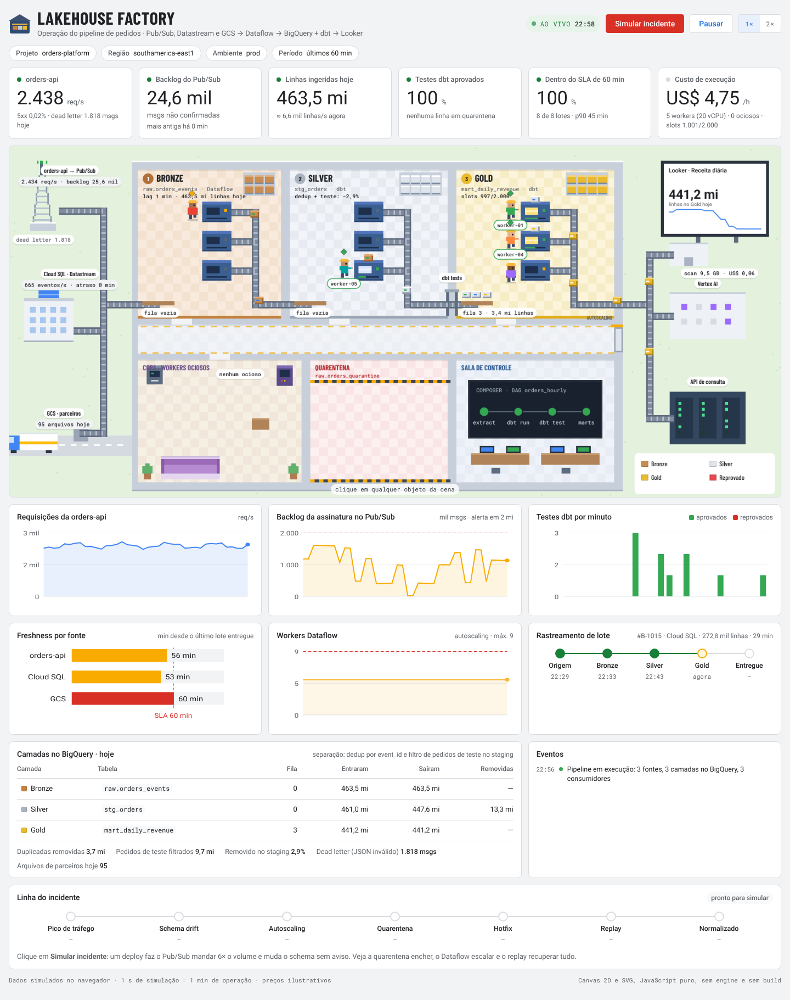
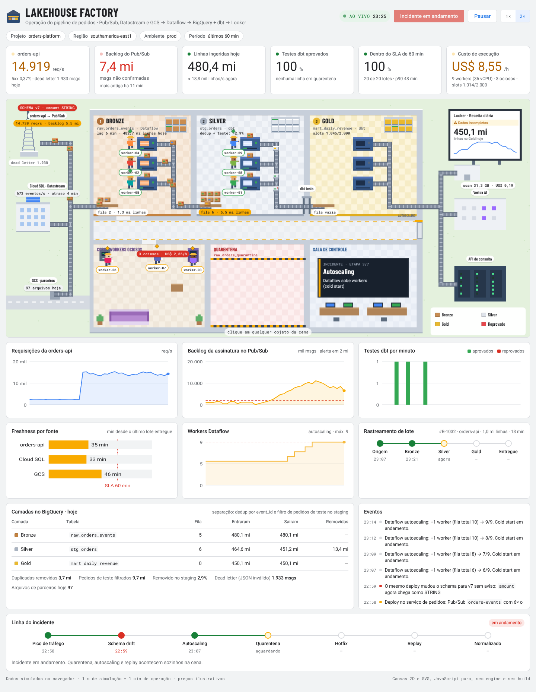

# Lakehouse Factory

A GCP data pipeline drawn as the floor plan of a working warehouse. Pub/Sub, Datastream and GCS deliver crates of data; Dataflow workers move them through the Bronze (raw), Silver (staging) and Gold (marts) zones of BigQuery; dbt tests at the exit of staging send bad batches to a quarantine room; marts feed Looker, Vertex AI and an API. Around the scene, a Looker-style dashboard reads the same state.

Volumes are sized like a large e-commerce operation (about 2,400 API requests per second, roughly 500 million rows a day). Every animation maps to something that happens in production: autoscaling with cold start, idle workers that keep billing, data contracts, quarantine, replay, freshness and SLA.

**Live demo:** https://jorgelira123.github.io/lakehouse-factory/ &nbsp;·&nbsp; [Versão em português](#versão-em-português)

> **Note:** the interface is in Portuguese. The table below maps every element of the scene, with its on-screen label, to what it represents.



## The incident

Press **Simular incidente** (simulate incident) and the scene plays a story I have lived more than once:

1. A deploy in the orders service makes Pub/Sub send **6× the normal volume**, and the same deploy changes the schema: `amount` now arrives as a **STRING**.
2. Queues grow. **Dataflow autoscaling** adds workers, and each new one pays a **cold start** before it can work.
3. The **contract on `stg_orders`** fails. Bad batches are thrown into `raw.orders_quarantine` instead of reaching the mart. Looker shows a "data incomplete" warning.
4. A **hotfix** goes out (`SAFE_CAST(amount AS NUMERIC)`). Batches already in flight still arrive broken, so the quarantine keeps catching them.
5. **Replay** sends every quarantined batch back to staging. No data is lost.
6. The pipeline normalizes. The rolling SLA % recovers more slowly than the queues, because late batches stay in the window for a while, as they do on a real dashboard.



## What each piece of the scene means

| In the scene (on-screen label) | In the platform |
|---|---|
| Radio tower, office building, trucks | Pub/Sub stream, Cloud SQL via Datastream CDC, daily Parquet files landing in GCS |
| People in hard hats (`worker-01`…) | Dataflow workers. New ones come out of the autoscaling elevator (cold start); idle ones go to the break room (COPA · WORKERS OCIOSOS) and keep billing. |
| Bronze, Silver and Gold zones | Medallion layers: `raw.orders_events` (Dataflow), `stg_orders` and `mart_daily_revenue` (dbt) |
| Shelf in each room | Partitions written to that table; the newest one blinks. |
| Stacks of crates by each layer (`fila 5 · 4,7 mi linhas`) | Backlog: batches and rows waiting. Tall stacks mean lag. |
| Scanner in the Silver → Gold wall (`dbt tests`) | dbt tests and model contract at the exit of staging |
| Quarantine room (QUARENTENA) | `raw.orders_quarantine`: rejected batches kept aside for replay, not dropped |
| Control room (SALA DE CONTROLE) | Cloud Composer DAG (extract, dbt run, dbt test, marts); during an incident its screen narrates each step |
| Looker screen (`Dados incompletos` = data incomplete) | The consumer people actually look at, with its BigQuery scan cost |
| Numbers on tags and tiles | What you would watch in Cloud Monitoring: API req/s and 5xx, Pub/Sub backlog and oldest unacked message, dead-letter count, Datastream replication lag, Dataflow system lag, BigQuery slots, rows in and out of each layer |
| Silver sign (`dedup + teste: −2,9%`) | Pub/Sub delivers at least once, so staging deduplicates by `event_id` and drops test orders. Around 3% of rows are removed there. |

A few on-screen words: *fila* = queue, *linhas* = rows, *lotes* = batches, *ociosos* = idle, *hoje* = today, *Pausar* = pause. Numbers use Brazilian format (`4,7 mi` = 4.7 million).

Click any object to inspect it. Sources show freshness, workers show cost so far, batches show their whole path, the pool shows how much idle capacity is burning per hour.

## How it is built

No framework, no game engine, no build step. Plain ES modules, Canvas 2D for the scene and SVG for the charts.

```
src/
  model.js    domain: sources, layers, consumers, dbt tests, prices. No coordinates.
  layout.js   where things sit in this view
  sim.js      rules: batches, queues, workers, autoscaling, tests, quarantine, incident script
  render.js   the floor plan: pixel art drawn small and scaled up, crisp labels on top; reads state, never changes it
  charts.js   small Looker-style SVG charts
  ui.js       KPI tiles, inspector, charts, batch tracking, incident timeline, events
  main.js     warm-up and main loop
```

The domain model carries no screen information. This project went through four visual versions (dark pixel art, isometric, a side cutaway, and this light floor plan). Each change meant rewriting `layout.js` and `render.js`; the domain model and the simulation logic carried over almost untouched. That separation is the point: once the data model is right, the visual layer is a choice.

All data is simulated in the browser. 1 second of simulation equals 1 minute of operation. Prices are illustrative.

## Run locally

ES modules need a local server (opening the file directly will not work):

```bash
python3 -m http.server 8000
# open http://localhost:8000
```

## Author

Built by Jorge Lira, data engineer working on GCP data platforms (BigQuery, Dataflow, Cloud Composer). Google Cloud Professional Data Engineer and Professional Cloud Architect, AWS Solutions Architect Associate, Databricks Data Engineer Associate. Built with Claude as a pair programmer.

[LinkedIn](https://www.linkedin.com/in/jorge-lira-dev) · [Portfolio](https://jorgelira123.github.io/)

---

## Versão em português

Um pipeline de dados no GCP desenhado como um galpão funcionando. Pub/Sub, Datastream e GCS entregam caixas de dados; workers do Dataflow (as empilhadeiras) levam as caixas pelas camadas raw, staging e marts no BigQuery; testes dbt na saída do staging derrubam lotes inválidos na quarentena do porão; os marts seguem para Looker, Vertex AI e uma API. Em volta da cena, um painel no estilo Looker lê o mesmo estado.

Clique em **Simular incidente**: um deploy faz o Pub/Sub mandar 6× o volume e muda o schema sem aviso, o contrato do `stg_orders` segura os lotes ruins antes do mart, o Dataflow escala, o hotfix entra, o replay devolve tudo para o staging e o pipeline volta ao normal sem perder nenhum lote.

Demo: https://jorgelira123.github.io/lakehouse-factory/ · Para rodar localmente: `python3 -m http.server 8000` e abra `http://localhost:8000`.

## License

MIT
